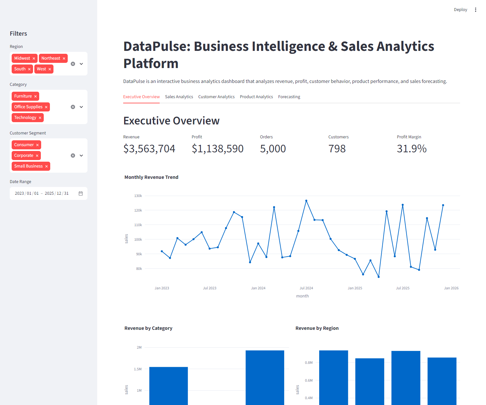

# DataPulse: Business Intelligence & Sales Analytics Platform

> **Summary:** An interactive Streamlit dashboard that runs SQL KPI queries on a SQLite sales database and adds customer, product and revenue-forecast views.
>
> **Tech stack:** Python, SQL (SQLite), pandas, NumPy, Plotly, scikit-learn, Streamlit



> **Note: all data is synthetic.** `src/generate_data.py` creates 5,000 randomly generated orders (seeded, so results are reproducible). No real company or customer data is used, and the findings below describe the generated data, not a real business.

DataPulse is an end-to-end business analytics dashboard built with Python, SQL, Pandas, Plotly, Scikit-Learn, and Streamlit.

The project analyzes sales performance, profitability, customer behavior, product trends, and revenue forecasting.

## Example findings (from the seeded synthetic data)

* **Technology drives revenue:** Technology is about $1.93M of $3.56M total revenue (54%), and the Laptop product alone is about $1.27M (36%).
* **Margin is flat:** profit margin is about 32% overall and within a point of that in each category (31.1% to 32.1%), so category mix matters more than margin differences. This is expected for generated data, where cost rates are drawn from the same random range.

## Features

- Synthetic business sales dataset
- SQLite database integration
- SQL-based KPI reporting
- Revenue and profit analysis
- Customer segmentation
- Product performance analysis
- Revenue forecasting
- Interactive Streamlit dashboard

## Tech Stack

- Python
- SQL
- SQLite
- Pandas
- NumPy
- Plotly
- Streamlit
- Scikit-Learn

## Project Structure

```text
DataPulse/
├── data/                  # sales_data.csv (generated, git-ignored)
├── database/              # datapulse.db SQLite file (generated, git-ignored)
├── src/
│   ├── generate_data.py   # creates the synthetic sales CSV
│   ├── build_database.py  # loads the CSV into SQLite
│   ├── analytics.py       # SQL queries used by the dashboard
│   └── forecasting.py     # linear-regression revenue forecast
├── dashboard/
│   └── app.py             # Streamlit dashboard
├── docs/
│   └── dashboard-overview.png
├── requirements.txt
└── README.md
```

## How to Run

Run all commands from the repository root (the scripts use relative paths).

```bash
pip install -r requirements.txt
python src/generate_data.py     # writes data/sales_data.csv
python src/build_database.py    # writes database/datapulse.db
streamlit run dashboard/app.py  # opens the dashboard at http://localhost:8501
```
